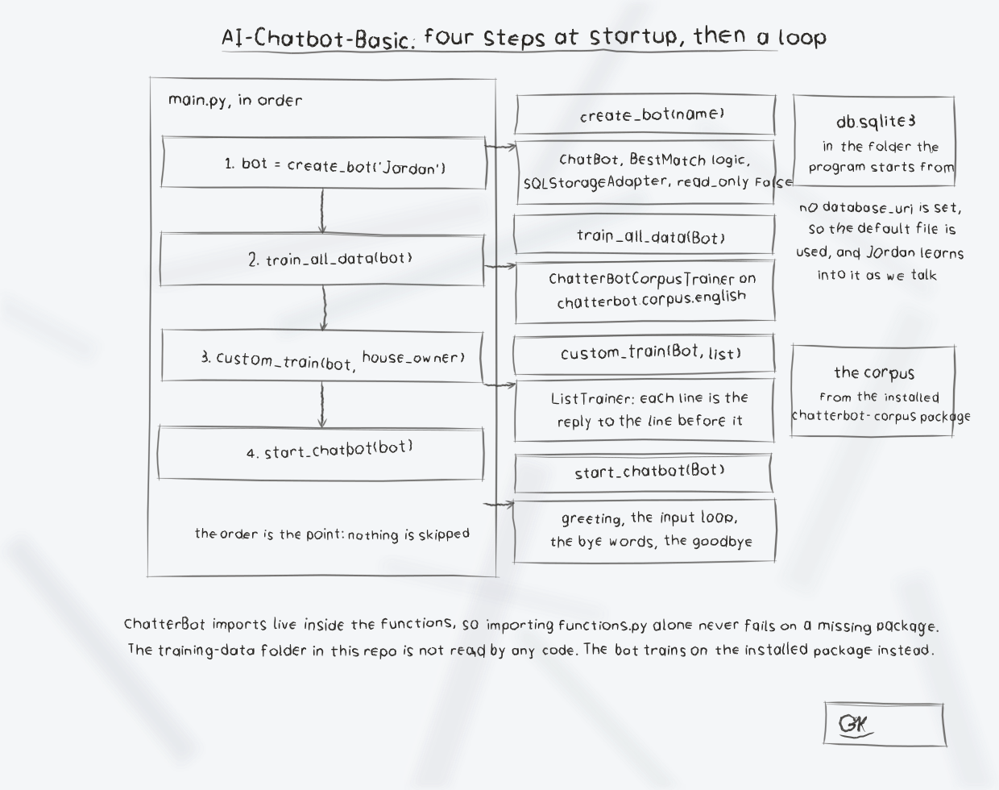

# AI-Chatbot-Basic

A basic chatbot named Jordan, built on ChatterBot. It answers basic
questions from the English ChatterBot corpus it is trained on at
startup, plus one custom trained answer, and it learns from the
conversation while it runs (its storage is a local SQLite database and
`read_only` is off).

## What the code does

- `functions.py`
  - `create_bot(name)`: builds a ChatterBot with the BestMatch logic
    adapter and SQL storage.
  - `train_all_data(bot)`: trains the bot on `chatterbot.corpus.english`
    from the installed chatterbot-corpus package. This runs on every
    launch and takes a few seconds.
  - `custom_train(bot, conversation)`: trains one question and answer
    pair with the ListTrainer.
  - `start_chatbot(bot)`: the chat loop. It greets you as Jordan and
    answers until you type one of the bye words below.
- `main.py`: creates the bot, trains the corpus, trains the custom pair
  ("Who is the owner of the house?" / "Mark Nicholas"), and starts the
  chat loop.

Exit the chat by typing `bye`, `bye jordan`, or `good bye`. If the
input simply ends (piped input runs out, stdin is closed, or you press
Ctrl-C), the bot prints the same goodbye message and exits cleanly.

Verified behaviour: asked "Who is the owner of the house?", the bot
answers "Mark Nicholas"; `bye` ends the session with "Jordan: Good bye
and have a blessed day!".

## Setup

Python 3, then:

```bash
pip install -r requirements.txt
python -m spacy download en_core_web_sm
python main.py
```

Each piece is required, and each missing piece fails in its own way
(all reproduced):

- Without ChatterBot installed: `ModuleNotFoundError: No module named 'chatterbot'`.
- Without the spaCy English model: ChatterBot reports that the spaCy
  model for the English language is missing. The model is a download
  step, not a pip requirement, which is why it is a separate command
  above.
- Without PyYAML: corpus training fails asking for it.
- Without the chatterbot-corpus package: there is no
  `chatterbot.corpus.english` data to train on.

## The training-data folder

`training-data/` holds YAML corpus files, and `training-data.md` in
that folder says "All of our training data is in this folder." That is
not how the code works: no code in this repo reads that folder (checked
by searching every Python and Markdown file), and its `greetings.yml`
is identical to the English `greetings.yml` inside the installed
chatterbot-corpus package. The bot trains on the installed package's
corpus, so editing the local copies does not change what the bot
learns. The folder is kept as a local reference copy of the corpus
format.

## Notes

- The bot creates its SQLite database (`db.sqlite3`) in the folder you
  run it from, and because it keeps learning, answers can drift over
  time. Delete the database to start over.
- The original one line description claimed the bot "converts natural
  language to machine code". It does not: nothing in the code converts
  anything to machine code. It is a question answering chatbot, as
  described above.

## License

See LICENSE.

## Diagrams and maps

I drew the system out in [AI-Chatbot-Basic-Visuals](AI-Chatbot-Basic-Visuals/): an architecture diagram, a data-flow diagram of where the bot's training actually comes from, a flowchart of a run, and a product map, with the written product map, statistics with citations, and the roadmap in [VISUAL.md](AI-Chatbot-Basic-Visuals/VISUAL.md). Every sheet also ships as a PNG photograph of the paper page beside its SVG.


